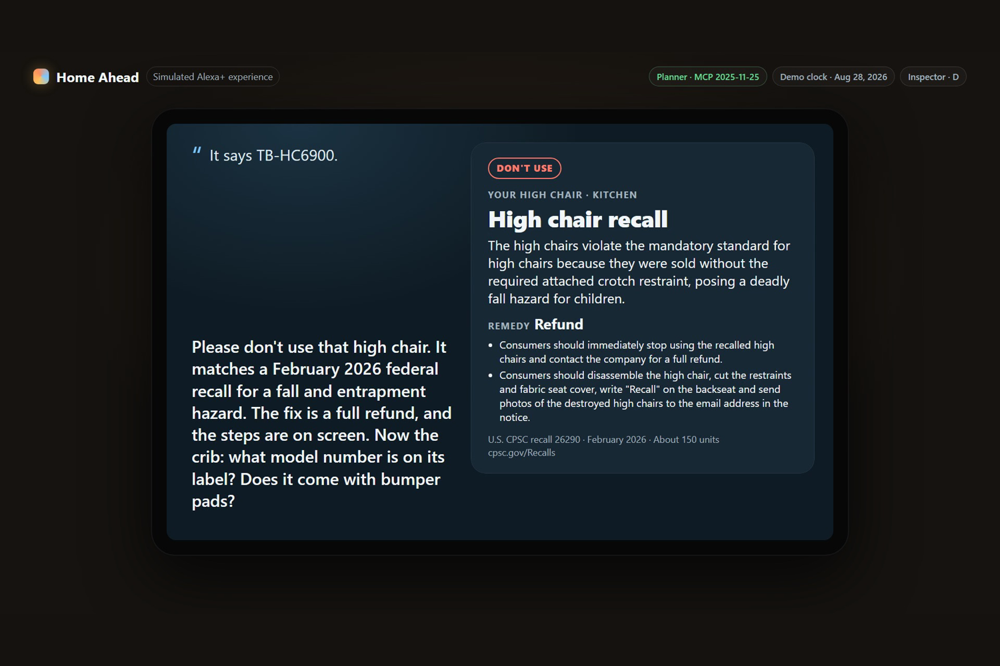
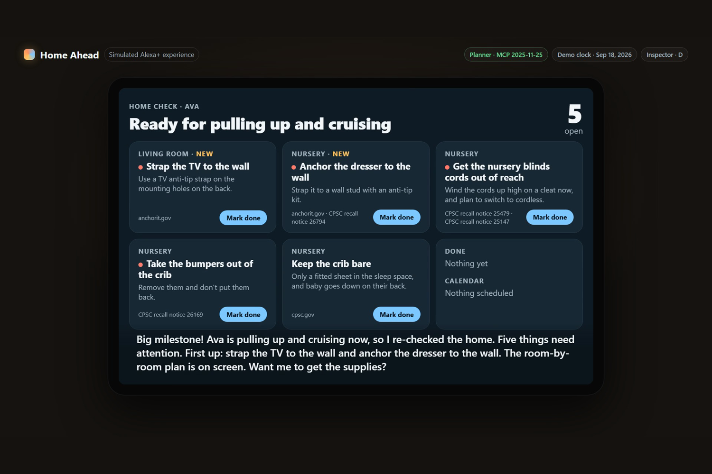
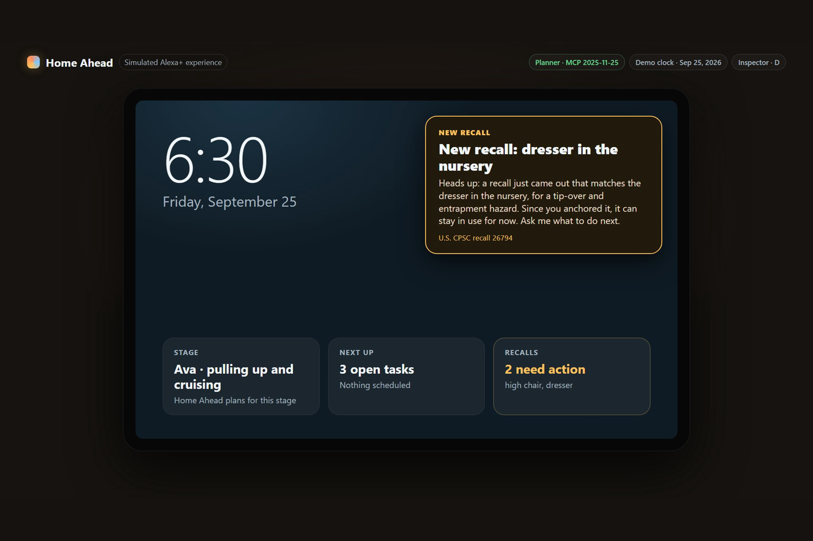
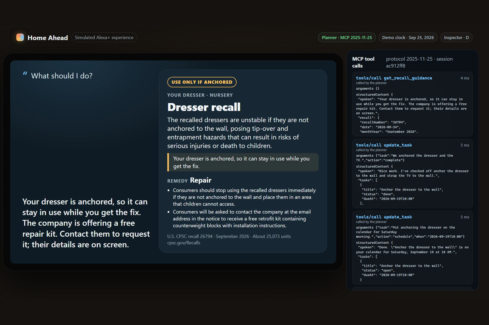
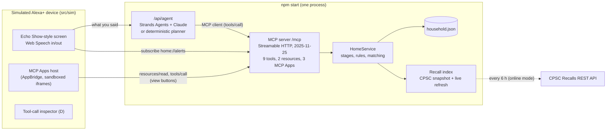

# Home Ahead

**A home that keeps up with your baby.** Home Ahead is an Alexa+ add-on (shown here as a simulated Alexa+ experience) and a self-hosted MCP server. It checks hand-me-downs against real U.S. recall notices, re-checks the home every time a child learns a new move, orders the safety supplies after you confirm, and tells you when a new recall reaches something you own.

> Built for the *Build, Ship, Shape: Amazon Developer Hackathon*, Alexa+ track. Home Ahead is an independent project and is not affiliated with or endorsed by Amazon. The Alexa+ screen in this repo is a simulation.

## Why

Babyproofing is usually done once, before the baby arrives. But the risks in a home change with every new move: a dresser that was fine for a crawler can tip onto a baby who pulls up on it, and blind cords come within reach. Families also lean on hand-me-downs (high chairs, cribs, dressers), and recalled products keep circulating long after a recall is announced.

Home Ahead keeps a small model of the home (rooms, items, where they came from) and of the child's stage, and does three things a voice assistant on a kitchen screen is good at:

1. **Checks hand-me-downs on the spot.** "My sister is giving us her old high chair." It asks for the model number on the label, matches it against U.S. Consumer Product Safety Commission (CPSC) recall notices, and says plainly whether to use it, fix it first, or not use it.
2. **Re-checks the home when the baby changes.** "She pulled herself up on the couch today!" The child moves to the *pulling up and cruising* stage, the room-by-room plan updates (anchor the dresser, strap the TV, get blind cords out of reach), it offers the supplies, and it puts the job on the calendar.
3. **Watches for new recalls.** When a recall that matches something in the home is published, the screen shows an alert without being asked. Because the family already anchored that dresser, it can say the dresser can stay in use while they get the free repair kit, and it tracks that request.

## What it looks like

The simulator (`npm run demo`, then open `http://127.0.0.1:8787/?demo=1`) plays the three-act demo on an Echo Show-style 1280×800 screen. Press **D** to open the MCP tool-call inspector.

| Hand-me-down check | Stage change: room-by-room plan |
| --- | --- |
|  |  |
| **New recall alert** | **What to do, with the tool calls behind it** |
|  |  |

## How it works



- **MCP server** (`src/server/mcp.ts`, `src/server/http.ts`): MCP TypeScript SDK v2 over Streamable HTTP, protocol version `2025-11-25`, with stateful sessions (`Mcp-Session-Id`, at most 100, closed after 30 idle minutes unless listening on SSE), SSE for server notifications, JSON-RPC errors for malformed requests, and Host/Origin validation for localhost. Any MCP client can connect to `http://127.0.0.1:8787/mcp`.
- **Tools** are intent-level, so a voice turn needs one call, and each returns a short `spoken` sentence (checked by tests to be speakable: no URLs, no JSON, no IDs, at most 70 words) plus `structuredContent` for the screen (the same data also goes, serialized, into a second text block for clients that read only `content`, as the MCP spec recommends):

  | Tool | What it does |
  | --- | --- |
  | `check_secondhand_item` | Verdict for a hand-me-down (`use`, `fix_first`, `do_not_use`, `need_info`) from recall matches and banned-product rules; asks for the model number when needed |
  | `set_child_stage` | Records a milestone ("pulled up"), moves the child to the right stage, re-audits the home, creates tasks |
  | `get_safety_plan` | Room-by-room plan for the current stage, or a preview of the next one |
  | `add_items` | Registers items (room, source) and checks them right away |
  | `check_recalls` | Re-checks everything in the home; new matches first |
  | `get_recall_guidance` | Stop using or not, the remedy, how to contact the company, a personal note (for example "your dresser is anchored") |
  | `prepare_supply_order` / `confirm_supply_order` | Two-step order from a demo store: prepare returns a token, confirm only after the user says yes; confirming twice never orders twice |
  | `update_task` | Complete, schedule ("Saturday morning"), snooze, or track a remedy request (adds a two-week follow-up) |

- **Resources**: `home://household` (summary) and `home://alerts` (subscribable; the server sends `notifications/resources/updated` when a new recall reaches the home or a child's age suggests a new stage).
- **MCP Apps** (`src/ui`): three views (recall card, safety plan, cart) bundled with esbuild into self-contained HTML, served as `ui://home-ahead/<view>-<hash>.html` resources and linked from tools with `_meta.ui.resourceUri`. The simulator hosts them in sandboxed iframes with the `@modelcontextprotocol/ext-apps` AppBridge and enforces each view's declared `_meta.ui.csp` with a Content-Security-Policy (no network access unless a view lists a domain); buttons inside a view call tools back through the host (*Place order*, *Mark done*).
- **Agent** (`src/agent`): with a model configured, a [Strands Agents](https://strandsagents.com/) agent talks to the MCP server through an MCP client and Claude (Claude Opus 5.5 by default) chooses the tools and writes the reply. With no key, a deterministic planner handles the demo conversation through the same MCP client, so anyone can run it offline. The simulator shows which one answered, and for model turns the inspector also shows the model, the number of requests and the tokens used.
- **Recall data** (`src/cpsc`): a snapshot of 280 CPSC notices for nursery and furniture products since 2023 ships in `data/cpsc/snapshot.json`; online mode fetches newer notices from the CPSC Recalls REST API every 6 hours. Model numbers, product categories and brands are extracted from each notice. Matching is `confirmed` (the model number on the label is in the notice and the product type agrees), `likely` (brand and product type match and the notice lists no model numbers), or `possible` (brand and type match but the item's model number is unknown, so Home Ahead asks for it instead of raising an alert). A known model number that is not in the notice is not a match.
- **Safety rules** (`data/rules/hazards.json`): each rule says which stages it applies to and cites a source, either a CPSC recall notice (number plus a verbatim quote from the snapshot) or a government page (URL, quote, date checked). A test checks every recall quote against the snapshot.
- **Demo clock**: demo mode starts on Friday, August 28, 2026 and the simulator moves the clock forward ("Three weeks later"). The recall index only shows notices published on or before the clock, so the dresser recall dated September 24, 2026 arrives during the demo exactly as it would have in real life.

## Run it

Requirements: Node.js 22.9 or newer (Node 24 recommended).

```bash
npm install
npm run demo        # demo mode: simulated clock, bundled snapshot, no network
```

Open `http://127.0.0.1:8787/` and type (or click the mic in Chrome and say) "My sister is giving us her old high chair and crib." To watch the full scripted demo, open `http://127.0.0.1:8787/?demo=1` (add `&tts=0` to mute the browser voice).

### Try saying

Without a model key, a deterministic planner understands these (a test sends every line below, in this order, through `/api/agent`). With a model key, say anything.

1. "My sister is giving us her old high chair and crib."
2. "It says TB-HC6900."
3. "Model CR-2208, and yes, it has bumpers."
4. "Is our dresser recalled?"
5. "She pulled herself up on the couch today!"
6. "What's left on the plan?"
7. "Order the safety supplies."
8. "Yes, place the order."
9. "Put anchoring the dresser on the calendar for Saturday morning."
10. "We anchored the dresser and the TV."
11. "We just got a bookcase for the living room."
12. "Check for recalls."
13. "Are we ready for the next stage?"

Normal mode keeps the household in `data/state/household.json`, uses the real clock in your computer's time zone, and refreshes recalls from the CPSC API (notices fetched after the snapshot are saved in `data/state/recalls.json`, so they still resolve after a restart or while offline):

```bash
npm start
```

### Use a model (optional)

Copy `.env.example` to `.env` and set one of:

- `ANTHROPIC_API_KEY`: the Strands agent uses Claude through the Anthropic API (model `claude-opus-5-5` unless `HOME_AHEAD_MODEL_ID` says otherwise).
- `AWS_REGION` plus `AWS_PROFILE` (or access keys) **and** `HOME_AHEAD_MODEL_ID`: the Strands agent uses Claude on Amazon Bedrock. There is no default Bedrock model, because model IDs and inference profiles differ by account and region; set one your account can invoke. Without it, the server says so at startup and uses the planner.

Without either, the deterministic planner answers. `HOME_AHEAD_AGENT=planner` forces the planner even when a key is set.

How the model path behaves (`src/agent/strands.ts`, `src/agent/api.ts`):

- **Request settings** for Claude Opus 5.5 through the Anthropic API: adaptive thinking with `low` effort (a voice turn should come back quickly; `HOME_AHEAD_EFFORT` changes it), `fallbacks: "default"` so a request declined by a safety classifier is retried on the model Anthropic recommends, and prompt caching for the tools, the system prompt and the conversation.
- **Append-only conversations**: the current date and any alert the screen announced since the last turn ride in the user's turn; the system prompt never changes and earlier turns are never trimmed or edited. That keeps the prompt cache warm and keeps Claude's earlier thinking blocks valid when they are sent back.
- **Falling back to the planner**: if the model declines, fails, or has not called a tool within 20 seconds, the planner answers that turn (and a run that was given up on can no longer call tools). If the model fails after a tool already ran, Home Ahead reports what the tool did instead of running the turn again. If the API refuses the key itself (invalid key, no credit or billing, no access, unknown model), the planner answers every turn from then on, without retrying.
- **Cost**: `HOME_AHEAD_USAGE_LOG=<file>` appends the token usage of every model request as one JSON line. In the recorded live take (`video/out_live`), each turn took two requests and 3 to 12 seconds, most about 6.

### Connect another MCP client

The server is a standard Streamable HTTP MCP server:

```bash
npx @modelcontextprotocol/inspector   # then connect to http://127.0.0.1:8787/mcp
```

### Environment variables

| Variable | Default | Meaning |
| --- | --- | --- |
| `PORT`, `HOST` | `8787`, `127.0.0.1` | Where the server listens |
| `HOME_AHEAD_DEMO` | off | Simulated clock, in-memory demo household, `/api/demo/*` endpoints (`npm run demo` sets it) |
| `HOME_AHEAD_OFFLINE` | off | Never call the CPSC API; use the snapshot only |
| `HOME_AHEAD_VIDEO_SAFE` | off | Replace company names, emails and links in recall text with neutral words (used for the demo video) |
| `HOME_AHEAD_STATE` | `data/state/household.json` | Household file in normal mode |
| `HOME_AHEAD_REFRESH_MINUTES` | `360` | How often online mode fetches new recalls |
| `HOME_AHEAD_AGENT` | auto | `planner` forces the planner; `bedrock` forces Bedrock |
| `HOME_AHEAD_MODEL_ID` | see above | Model ID for Anthropic (optional) or Bedrock (required) |
| `HOME_AHEAD_EFFORT` | `low` | Effort for Claude through the Anthropic API (`low`, `medium`, `high`, `xhigh`, `max`) |
| `HOME_AHEAD_USAGE_LOG` | off | File to append each model request's token usage to (JSON lines) |
| `HOME_AHEAD_TZ` | your system zone (`UTC` in demo mode) | IANA time zone for calendar times such as "Saturday morning" |

## Tests

```bash
npm test               # unit + MCP protocol + agent tests (vitest), no network
npx playwright install chromium
npm run test:e2e       # the simulator in a real browser (Playwright)
npm run typecheck
npm run test:live      # optional: the demo conversation with a real model (needs ANTHROPIC_API_KEY in .env; costs a few cents)
```

`npm run typecheck:video` also checks the video builder after `npm install` inside `video/`.

- `tests/unit`: the three demo acts at service level, recall matching and model-number extraction, rules and their sources, speech checks, video-safe redaction, live recall refresh and restart consistency (with a fake CPSC API), time zones, past-time scheduling, expired carts, and the MCP Apps CSP.
- `tests/mcp/protocol.test.ts`: real HTTP against the server: `2025-11-25` negotiation, unknown versions, foreign `Origin` and `Host` rejected, missing or unknown sessions, malformed JSON (JSON-RPC parse error), GET SSE streams, DELETE, session cap and idle timeout, `tools/list` schemas, `tools/call` results and errors, input validation, UI resources, and a resource-update notification to an SDK v1 client.
- `tests/mcp/agent.test.ts`: the whole demo conversation through `/api/agent`, every "Try saying" line above, off-script questions, and the Strands Agents path with scripted models (no API key needed): tool calls, the date in each user turn with an unchanged system prompt, and failures before and after a tool call.
- `tests/mcp/claude-path.test.ts`: the real Strands Anthropic model against a fake Anthropic API: the request settings above, append-only history with thinking blocks sent back unchanged, alerts passed to the next turn, a declined request, a refused key (billing), a slow or silent model, and the usage log.
- `tests/live` (`npm run test:live` only): the demo conversation with Claude; it checks that the model reaches the same tool results as the planner (the recalled high chair, the crib bumpers, the stage change, the order, the calendar slot, the dresser recall guidance).
- `tests/e2e`: the scripted demo plays to the end in Chromium (both video scripts) without text sliding under the app view or the alert card; a button inside an MCP App calls a tool through the host; the recall card renders and resizes; a model reply shows its model and token use.

`npm test` and `npm run test:e2e` never call external APIs: the CPSC client is tested with a recorded response and the agent with scripted models or a fake Anthropic API.

## Demo video

Watch it on YouTube: https://youtu.be/YZ5wRwIlwLE

`npm run video` records the scripted demo and builds `video/out/home-ahead-demo.mp4` (under 3 minutes), an `.srt` subtitle file and five 3:2 screenshots. It runs the demo twice: first fast, to collect every spoken line, then at real speed while capturing the screen through the Chrome DevTools screencast (JPEG frames with timestamps, encoded with x264 at CRF 18 so small text stays sharp), after generating each line with the open [Kokoro-82M](https://huggingface.co/hexgrad/Kokoro-82M) text-to-speech model (Apache-2.0) so the screen waits exactly as long as each voice clip. ffmpeg mixes the clips, plus a synthesized two-tone chime for each proactive alert, at the marked times. It needs `ffmpeg` on the PATH and `npm install` inside `video/` (downloads the model on first run). The video uses no music.

**What is live in the videos.** The published video above was recorded with the deterministic planner, so every reply in it is the planner's. `npm run video -- --live` builds a shorter cut (`video/out_live/home-ahead-demo-live.mp4`, script `video/script-live.json`) against a live model: every reply is whatever Claude Opus 5.5 said through the Strands agent during the recording, the waits for the model are real, and the inspector is open throughout. Only the user's lines, the narration and the alerts are fixed. Because the replies are only known while recording, their voice-over is generated afterwards: a reply that would run into the next line is read slightly faster, and the silent pause after a reply has been read (the simulator holds it on screen for a word-count estimate) is cut down to half a second. The wait for the model before each reply is not cut. While recording, the thinking light stays lit instead of pulsing: a pulsing light kept the screen capture busy and left the picture several seconds behind the voice.

## Project layout

```
src/
  main.ts, app.ts       start the server, agent and simulator in one process
  server/               MCP server, HTTP routes, MCP Apps bundling, scheduler, calendar (.ics)
  domain/               stages, rules, matching, recall view, speech, HomeService
  cpsc/                 CPSC API client, normalization, recall index
  agent/                MCP client, Strands agent, deterministic planner
  ui/                   MCP Apps views (recall card, safety plan, cart)
  sim/                  the simulated Alexa+ device
data/                   CPSC snapshot, safety rules, demo store catalog, demo household
scripts/build-snapshot.ts   rebuilds the CPSC snapshot (npm run snapshot)
video/                  demo script and video builder
tests/                  unit, MCP and end-to-end tests
```

## Data sources and licenses

- **Recall notices**: U.S. Consumer Product Safety Commission, Recalls REST API (`saferproducts.gov/RestWebServices/Recall`). Works of the U.S. federal government are not subject to copyright in the U.S. (17 U.S.C. 105). Product images are not stored.
- **Safety guidance quotes**: U.S. government pages (CPSC Anchor It! at anchorit.gov and CPSC Safe Sleep), quoted with the date they were checked, and CPSC recall notices.
- **Demo store** (`data/catalog.json`): made-up, brand-free products and prices. Nothing is bought or charged.
- **Demo household** (`data/demo/household.json`): fictional.
- **Voice in the demo video**: Kokoro-82M (Apache-2.0), generated locally.
- Home Ahead's guidance is general safety information, not professional advice. Always follow the official recall notice.

## AI tools used

- **Claude Code** (Claude Opus 5.5) helped design, write and test this code and its documentation.
- **Claude** (via the Anthropic API or Amazon Bedrock) is the optional runtime model behind the Strands agent; the planner answers without it.
- **Kokoro-82M** generates the narration and dialogue voices in the demo video.

## License

[MIT](LICENSE)
